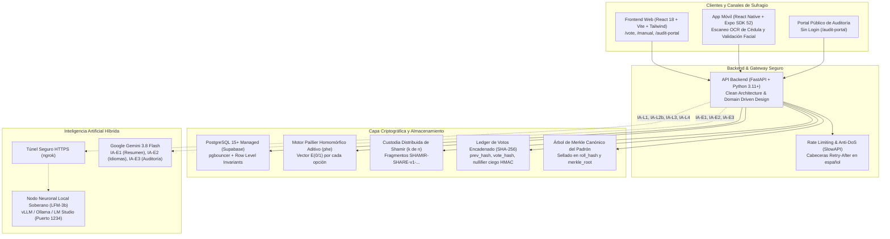

# VotoSeguro v3.0.0 — Plataforma de Voto Electrónico Criptográfico y Transparente con IA

> **INF 422 SB — Ingeniería de Software I (UAGRM)**  
> **Versión Oficial:** `v3.0.0` (Release Final Certificado — Sprint 3 Completo)  
> **Garantías Criptográficas:** Criptosistema Homomórfico Aditivo Paillier (1024/2048 bits) + Compartición de Secretos de Shamir ($k$ de $n$) + Libro Mayor Encadenado SHA-256 + Árbol de Merkle + $k$-Anonimato + IA Híbrida Soberana.

---

## 🏛️ 1. Visión General y Arquitectura del Sistema

**VotoSeguro v2/v3** es una plataforma integral de sufragio digital multi-institución diseñada para elecciones universitarias, gremiales y corporativas. Su núcleo combina privacidad matemática absoluta (el voto nunca viaja ni se almacena en texto plano) con verificabilidad universal de extremo a extremo (*End-to-End Verifiability — E2E-V*).



---

## 🔒 2. Invariantes de Seguridad y Criptografía

El sistema cumple rigurosamente con los 20 invariantes de diseño arquitectónico:

1. **Invariante #3 (Congelamiento Estructural):** Tras la publicación formal (`config_hash`), queda prohibido añadir, editar o eliminar candidatos, cargos o circunscripciones (responde con HTTP 409 Conflict).
2. **Invariante #6 (Tiempo Canónico):** Todo evento y transición temporal se calcula contra el reloj UTC canónico de la base de datos (`SELECT now() AT TIME ZONE 'UTC'`).
3. **Invariante #9 (Desvinculación Criptográfica Total):** La tabla de votos carece de `voter_id` y de cualquier identificador directo. El sufragio y la identidad del elector son matemáticamente imposibles de relacionar.
4. **Invariante #11 (Hermetismo de Resultados en Urna Abierta):** Mientras la votación permanezca en `VOTING_OPEN`, cualquier consulta a los resultados está bloqueada con HTTP 403 Forbidden.
5. **Invariante #12 ($k$-Anonimato en Escrutinio):** Los desgloses jerárquicos suprimen automáticamente los conteos en nodos con menos de 5 sufragantes para evitar deducción indirecta.
6. **Invariante #13 (Cifrado Paillier Homomórfico):** Cada papeleta es un vector de cifrados asimétricos Paillier $E(0)$ o $E(1)$. La urna se suma algebraicamente en el espacio cifrado:
   $$\prod_{i=1}^{M} c_i \pmod{n^2} = E\left(\sum_{i=1}^{M} m_i\right)$$
7. **Invariante #14 (Protección Estricta contra Fuga de PII):** Cero datos personales o cédulas en prompts a LLMs externos o registros de bitácora.
8. **Invariante #15 (Privacidad Biométrica Efímera):** Las imágenes capturadas para OCR de cédula (`IA-L3`) o liveness facial (`IA-L4`) se procesan en la memoria RAM y se destruyen inmediatamente tras la inferencia. Cero persistencia en disco o BD.
9. **Invariante #19 (Cadena de Bloques del Ledger):** Cada voto genera un bloque encadenado inmutable mediante `prev_hash` y `vote_hash`. Cualquier alteración es detectada instantáneamente.
10. **Invariante #20 (Custodia de Claves de Shamir):** La clave privada de descifrado Paillier se fragmenta en $n$ partes y se destruye en la memoria durante la ceremonia de inicio. Se requiere el quórum de $k$ custodios para el escrutinio.

---

## 📁 3. Estructura del Monorepo

```text
votoseguro/
├── apps/
│   ├── api/                     # Backend FastAPI (Python 3.11+)
│   │   ├── app/
│   │   │   ├── ai/              # Clientes de IA Local (LFM-3b) y Nube (Gemini 3.8)
│   │   │   ├── core/            # Configuración, excepciones, seguridad, rate-limiting
│   │   │   ├── db/              # Modelos ORM SQLAlchemy y migraciones
│   │   │   └── modules/         # Módulos de dominio (elections, voters, ballot, results, etc.)
│   │   ├── tests/               # 52 Pruebas de Invariantes y Certificación E2E (pytest)
│   │   └── pyproject.toml
│   ├── web/                     # Frontend Web SPA (React 18 + Vite + Tailwind CSS)
│   │   ├── src/pages/           # Vistas (Voter, Admin, Ceremony, Audit Portal, Manual)
│   │   └── package.json
│   └── mobile/                  # Aplicación Móvil (React Native + Expo SDK 52)
│       ├── app/                 # Pantallas nativas y componentes biométricos
│       └── package.json
├── docs/
│   ├── MANUAL_USUARIO.md        # Manual exhaustivo de 5 secciones en español
│   ├── GUIA_DESPLIEGUE_NUBE.md  # Guía de despliegue en Render, Supabase, Vercel y Expo
│   ├── DECISIONES.md            # Registro formal de Decisiones de Arquitectura (ADR)
│   ├── PROGRESO.md              # Bitácora de ejecución de Sprints 1, 2, 2.5 y 3
│   └── REPORTE_EVALUACION_LFM3.md
├── tests/
│   └── load/                    # Suite de Pruebas de Carga Masiva (k6)
│       ├── prepare_load_test_election.py  # Aprovisionador de 1,000 votantes y credenciales
│       ├── votoseguro_load_test.js        # Script k6 con rampa hasta 1,000 VUs concurrentes
│       ├── run_load_benchmark.py          # Runner asíncrono en Python para CI / local
│       ├── voters_credentials.json        # Dataset de credenciales activas
│       └── README_LOAD_TESTING.md         # Documentación técnica de pruebas de estrés
├── INICIAR_IA_LOCAL.bat         # Orquestador del nodo neuronal local LFM-3b + ngrok
└── package.json                 # Monorepo Turborepo + pnpm
```

---

## ⚡ 4. Puesta en Marcha en Desarrollo Local

### Prerrequisitos
- **Python 3.11+**
- **Node.js 20+** y **pnpm 9+**
- **PostgreSQL 15+** (o instancia gestionada en Supabase)

### 4.1 Backend (FastAPI)
```bash
cd apps/api
python -m venv .venv
# En Windows:
.venv\Scripts\activate
# En Linux/macOS:
source .venv/bin/activate

pip install -r requirements.txt
uvicorn app.main:app --reload --host 0.0.0.0 --port 8000
```
La documentación interactiva OpenAPI (Swagger) estará disponible en:  
`http://localhost:8000/docs`

### 4.2 Frontend Web (React + Vite)
```bash
# Desde la raíz del repositorio:
pnpm install
pnpm --filter @votoseguro/web dev
```
La aplicación web se iniciará en `http://localhost:5173`.  
Rutas destacadas:
- `/vote`: Cabina de votación cifrada multilingüe con modo de voz accesible.
- `/manual`: Manual interactivo de usuario y administración integrado en la aplicación.
- `/audit-portal`: Portal público de auditoría y verificación de sellos sin inicio de sesión.
- `/verify-receipt`: Validador criptográfico de comprobantes en el libro mayor.

### 4.3 App Móvil (Expo)
```bash
cd apps/mobile
npm install
npx expo start
```

---

## 🧪 5. Verificación de Calidad y Pruebas Automatizadas

### 5.1 Suite Completa de Invariantes y Certificación E2E (`pytest`)
Ejecute la batería completa de 52 pruebas de invariantes:
```bash
cd apps/api
.venv\Scripts\python.exe -m pytest -v
```
**Resultado de Certificación:**
```text
======================= 52 passed in 65.34s =======================
```
Incluye la prueba de certificación final de release:  
`tests/test_final_e2e_v3_release_audit.py` que recorre en un solo flujo continuo el 100% de los requisitos de los Sprints 1, 2, 2.5 y 3.

### 5.2 Compilación de Frontend Web y App Móvil
```bash
# Frontend Web
pnpm --filter @votoseguro/web build

# Verificación de tipos TypeScript en App Móvil
cd apps/mobile
npx tsc --noEmit
```

### 5.3 Pruebas de Carga y Concurrencia con k6 (1,000 VUs)
Para validar el requerimiento no funcional de emisión de papeleta en menos de 2 segundos ($p(95) < 2000\text{ms}$) bajo 1,000 usuarios concurrentes:

1. **Aprovisionar elección y 1,000 electores:**
   ```bash
   cd apps/api
   .venv\Scripts\python.exe ../../tests/load/prepare_load_test_election.py --voters 1000
   ```
2. **Ejecutar test oficial con k6:**
   ```bash
   k6 run tests/load/votoseguro_load_test.js
   ```
3. **O ejecutar el runner asíncrono en Python:**
   ```bash
   cd apps/api
   .venv\Scripts\python.exe ../../tests/load/run_load_benchmark.py --url http://localhost:8000/api/v1 --concurrency 100 --voters 500
   ```

Consulte [tests/load/README_LOAD_TESTING.md](tests/load/README_LOAD_TESTING.md) para detalles sobre etapas y umbrales.

---

## 📚 6. Enlaces a Documentación y Guías

- 📖 **[Manual de Usuario y Operación (docs/MANUAL_USUARIO.md)](docs/MANUAL_USUARIO.md):** Guía exhaustiva en 5 secciones (Elector, Administrador General, Custodios Shamir, Observadores y Nodo Local).
- ☁️ **[Guía de Despliegue en la Nube (docs/GUIA_DESPLIEGUE_NUBE.md)](docs/GUIA_DESPLIEGUE_NUBE.md):** Manual de puesta en producción en Supabase, Render, Vercel y Expo EAS.
- 🚀 **[Guía de Pruebas de Carga k6 (tests/load/README_LOAD_TESTING.md)](tests/load/README_LOAD_TESTING.md):** Escenarios de estrés, thresholds p95 y aprovisionamiento.
- 📐 **[Registro de Decisiones Arquitectónicas (docs/DECISIONES.md)](docs/DECISIONES.md):** Bitácora técnica de decisiones de diseño.
- 📊 **[Bitácora de Progreso (docs/PROGRESO.md)](docs/PROGRESO.md):** Certificación del 100% de tareas completadas de los Sprints 1, 2, 2.5 y 3.

---

## 👥 Equipo de Desarrollo y Créditos

- **Proyecto:** VotoSeguro v2/v3 — INF 422 SB (Ingeniería de Software I)
- **Institución:** Universidad Autónoma Gabriel René Moreno (UAGRM) — Facultad Integral del Chaco / FICCT
- **Licencia:** MIT License — Código Abierto para Fines Cívicos y Académicos
