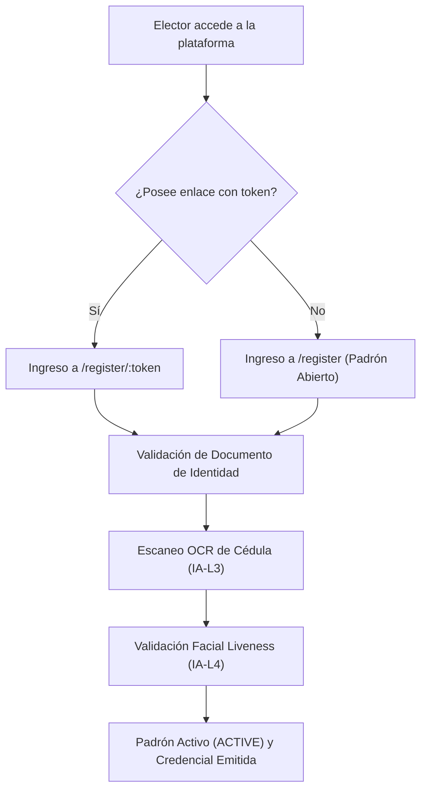
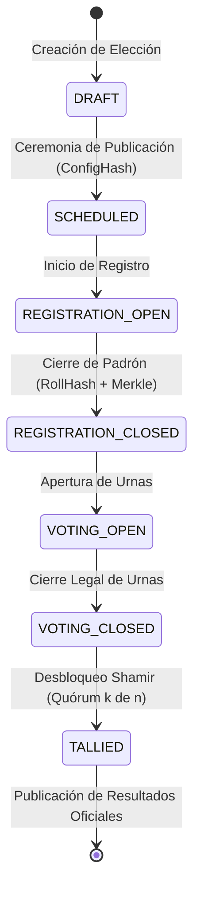
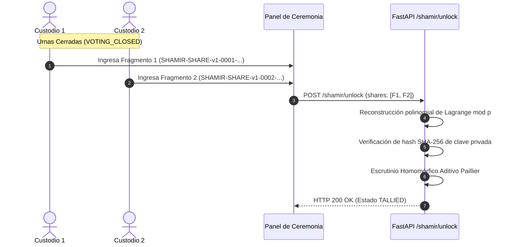

# Manual de Usuario y Guía Operativa Oficial — VotoSeguro v3.0.0
**Plataforma de Voto Electrónico Criptográfico y Transparente con Inteligencia Artificial**  
*Asignatura:* Ingeniería de Software I (INF 422 SB) — UAGRM  
*Versión:* `v3.0.0` (Release Final Certificado — Sprint 3)

---

## Índice General

1. [Sección 1: Guía del Elector (Web y App Móvil)](#sección-1-guía-del-elector-web-y-app-móvil)
   - [1.1 Activación de Cuenta y Autoinscripción](#11-activación-de-cuenta-y-autoinscripción)
   - [1.2 Escaneo OCR de Cédula y Validación Biométrica Facial](#12-escaneo-ocr-de-cédula-y-validación-biométrica-facial)
   - [1.3 Selección de Lengua Originaria y Accesibilidad](#13-selección-de-lengua-originaria-y-accesibilidad)
   - [1.4 Ingreso a la Cabina de Votación y Sufragio Cifrado](#14-ingreso-a-la-cabina-de-votación-y-sufragio-cifrado)
   - [1.5 Modo Accesible Asistido por Voz](#15-modo-accesible-asistido-por-voz)
   - [1.6 Comprobante de Voto, Verificación y Árbol de Merkle](#16-comprobante-de-voto-verificación-y-árbol-de-merkle)
2. [Sección 2: Guía del Administrador General (ADMIN_GENERAL)](#sección-2-guía-del-administrador-general-admin_general)
   - [2.1 Configuración y Parametrización de Elecciones](#21-configuración-y-parametrización-de-elecciones)
   - [2.2 Cronograma Electoral Dinámico y Matriz de Transiciones](#22-cronograma-electoral-dinámico-y-matriz-de-transiciones)
   - [2.3 Definición de Estructura Jerárquica, Nodos y Candidaturas](#23-definición-de-estructura-jerárquica-nodos-y-candidaturas)
   - [2.4 Ceremonia Criptográfica de Claves Paillier y Shamir](#24-ceremonia-criptográfica-de-claves-paillier-y-shamir)
   - [2.5 Publicación y Congelamiento Estructural (ConfigHash)](#25-publicación-y-congelamiento-estructural-confighash)
   - [2.6 Gestión del Padrón y Arbitraje Asistido de Duplicados](#26-gestión-del-padrón-y-arbitraje-asistido-de-duplicados)
   - [2.7 Cierre de Padrón y Sellado Criptográfico (RollHash y Merkle)](#27-cierre-de-padrón-y-sellado-criptográfico-rollhash-y-merkle)
   - [2.8 Monitoreo en Vivo y Detección de Anomalías](#28-monitoreo-en-vivo-y-detección-de-anomalías)
   - [2.9 Cierre de Urnas, Desbloqueo y Escrutinio Homomórfico](#29-cierre-de-urnas-desbloqueo-y-escrutinio-homomórfico)
   - [2.10 Generación de Informes Ejecutivos y Exportación de Actas](#210-generación-de-informes-ejecutivos-y-exportación-de-actas)
3. [Sección 3: Guía de Custodios Electorales (Quórum Shamir k de n)](#sección-3-guía-de-custodios-electorales-quórum-shamir-k-de-n)
   - [3.1 Responsabilidad Institucional del Custodio](#31-responsabilidad-institucional-del-custodio)
   - [3.2 Resguardo y Confidencialidad de Fragmentos](#32-resguardo-y-confidencialidad-de-fragmentos)
   - [3.3 Procedimiento de Apertura de Urna y Quórum](#33-procedimiento-de-apertura-de-urna-y-quórum)
4. [Sección 4: Guía del Delegado de Segmento y Observador Público](#sección-4-guía-del-delegado-de-segmento-y-observador-público)
   - [4.1 Acceso al Portal Público de Auditoría](#41-acceso-al-portal-público-de-auditoría)
   - [4.2 Verificación Independiente de Sellos Criptográficos](#42-verificación-independiente-de-sellos-criptográficos)
   - [4.3 Auditoría de Integridad del Ledger de Votos y Cronograma](#43-auditoría-de-integridad-del-ledger-de-votos-y-cronograma)
5. [Sección 5: Operación del Nodo Neuronal Local (INICIAR_IA_LOCAL.bat)](#sección-5-operación-del-nodo-neuronal-local-iniciar_ia_localbat)
   - [5.1 Arquitectura del Nodo de Inferencia Local](#51-arquitectura-del-nodo-de-inferencia-local)
   - [5.2 Puesta en Marcha con el Script Automatizado](#52-puesta-en-marcha-con-el-script-automatizado)
   - [5.3 Gestión del Túnel Seguro ngrok y Monitoreo](#53-gestión-del-túnel-seguro-ngrok-y-monitoreo)

---

## Sección 1: Guía del Elector (Web y App Móvil)

El sistema **VotoSeguro v2** garantiza a cada votante el ejercicio de un sufragio libre, secreto, informado y auditable de punta a punta.

### 1.1 Activación de Cuenta y Autoinscripción

Existen dos vías para incorporarse al padrón electoral activo:

1. **Por Enlace Seguro de Activación (`/register/:token`):**
   - El elector recibe un correo institucional con un enlace tokenizado de un solo uso.
   - Al pulsar el enlace, el sistema valida la vigencia del token y solicita la confirmación de la Cédula de Identidad (CI) y la creación de una contraseña segura o verificación de credencial.
2. **Por Autoinscripción Abierta (`/register`):**
   - Disponible únicamente si la administración habilitó la auto-inscripción durante la fase de `REGISTRATION_OPEN`.
   - El elector ingresa sus nombres completos, documento de identidad, correo institucional y el código de su unidad académica o carrera.



### 1.2 Escaneo OCR de Cédula y Validación Biométrica Facial

Para evitar suplantaciones de identidad y garantizar que nadie vote dos veces:
1. **Captura de Cédula (`IA-L3`):**  
   - En la aplicación móvil o web, apunte la cámara al anverso de la cédula de identidad boliviana.
   - El motor neuronal local extrae automáticamente el número de documento, nombres y apellidos con precisión sub-segundo.
2. **Validación Facial y Prueba de Vida (`IA-L4`):**  
   - Se solicita una captura facial en vivo con una instrucción dinámica (ej. parpadear o girar levemente el rostro).
   - **Invariante de Privacidad Biométrica (#15):** Las imágenes capturadas **nunca se guardan en el disco ni en la base de datos**. Se procesan efímeramente en la memoria RAM y se destruyen inmediatamente tras generar el vector de validación.

### 1.3 Selección de Lengua Originaria y Accesibilidad

VotoSeguro incluye soporte multilingüe nativo con traducción y contextualización asistida por IA (`IA-E2`):
- **Lenguas Disponibles:** Español, Quechua (*Runa Simi*), Aymara y Guaraní.
- Para cambiar de idioma, seleccione el selector de banderas en la esquina superior derecha de la cabina de votación. Toda la interfaz, papeletas e instrucciones de voz se adaptarán inmediatamente.

### 1.4 Ingreso a la Cabina de Votación y Sufragio Cifrado

Una vez abierta la jornada de votación (`VOTING_OPEN`):
1. Ingrese a `/vote` o abra la app móvil.
2. Introduzca su **Cédula de Identidad** y su **Código de Credencial Secreto** (ej. `VS-2026-X8F9-Q2M7`).
3. El sistema verificará que su credencial sea válida, que se encuentre en estado `ACTIVE` y que no haya emitido su voto previamente.
4. Se desplegará la papeleta electoral oficial correspondiente a su unidad académica y jerarquía (Campus, Facultad, Carrera).
5. Seleccione su opción de voto para cada cargo:
   - **Candidato Oficial** (marcando la casilla correspondiente).
   - **Voto en Blanco** (botón neutro oficial).
   - **Voto Nulo** (marcando anulación expresa).
6. Al presionar **"Confirmar y Emitir Mi Voto"**:
   - El navegador o dispositivo móvil cifra el vector de selección utilizando la **Clave Pública Paillier de 1024 o 2048 bits**.
   - Se genera el **Nullifier Determinista Ciego** $\text{HMAC-SHA256}(\text{seed}, \text{voter\_id} \mathbin{\Vert} \text{":"} \mathbin{\Vert} \text{constituency\_id})$ para evitar el doble voto sin revelar la identidad.
   - El voto cifrado se almacena en el libro mayor inmutable encadenado (`ledger`).
   - Se emite el comprobante de voto con el hash criptográfico único.

### 1.5 Modo Accesible Asistido por Voz

Para personas con discapacidad visual o motora:
- Active el interruptor de accesibilidad **"Modo Voz Asistida"**.
- El asistente narrará en voz alta cada opción de la papeleta con síntesis de voz clara.
- El usuario puede confirmar su elección mediante comandos de voz sencillos (*"Opción 1"*, *"Voto Blanco"*, *"Confirmar Voto"*).

### 1.6 Comprobante de Voto, Verificación y Árbol de Merkle

Al concluir la emisión, el sistema entrega un comprobante digital:
- **Hash del Comprobante (`receipt_hash`):** Cadena SHA-256 de 64 caracteres hexadecimales.
- **Descarga:** Puede descargarlo en PDF, imagen PNG con código QR o copiar el hash al portapapeles.
- **Verificación en Urna (`/verify-receipt`):**  
  En cualquier momento, cualquier ciudadano puede ingresar a `/verify-receipt` y pegar su hash para confirmar:
  1. Que el comprobante existe en la urna oficial.
  2. Que la cadena de bloques interna del libro mayor no ha sufrido ninguna manipulación.
  3. Que su papeleta se encuentra sellada dentro de la raíz del **Árbol de Merkle (`merkle_root`)** generado al cierre del padrón.

---

## Sección 2: Guía del Administrador General (ADMIN_GENERAL)

El Administrador General tiene a su cargo el gobierno integral de la plataforma institucional.



### 2.1 Configuración y Parametrización de Elecciones

1. Navegue al módulo **Elecciones** y presione **"Nueva Elección"**.
2. Defina los parámetros base:
   - **Nombre de la Elección:** Ej. *"Elecciones FUL y Centros Internos 2026-2028"*.
   - **Zona Horaria:** `America/La_Paz` (GMT-4).
   - **Umbral de Privacidad $k$-Anonimato:** Mínimo 5 electores por celda desglosada.
   - **Esquema Criptográfico:** `PAILLIER_HOMOMORPHIC` (1024 o 2048 bits).
   - **Parámetros Shamir:** Total de custodios ($n$) y quórum mínimo requerido ($k$), ej. $k=2, n=3$ o $k=3, n=5$.

### 2.2 Cronograma Electoral Dinámico y Matriz de Transiciones

El cronograma rige las 4 fechas críticas de la elección:
$$\text{registration\_opens\_at} < \text{registration\_closes\_at} \le \text{voting\_opens\_at} < \text{voting\_closes\_at}$$

- **Regla de Invarianza de Cronograma:**  
  Cualquier modificación posterior al estado `DRAFT` requiere ingresar un **Motivo Formal Justificativo** (mínimo 10 caracteres). Cada cambio queda registrado en la tabla inmutable `schedule_change` y en la bitácora encadenada `audit_log`.
- Durante `VOTING_OPEN`, únicamente se autoriza la ampliación de `voting_closes_at` con un margen mínimo de 5 minutos sobre la hora del servidor.

### 2.3 Definición de Estructura Jerárquica, Nodos y Candidaturas

1. **Grupos de Votantes:** Permite segmentar por estamentos (ej. `ESTUDIANTES`, `DOCENTES`).
2. **Niveles Jerárquicos:** Configure la profundidad organizacional:
   - Nivel 1: Universidad / Campus.
   - Nivel 2: Facultad (ej. FICCT, Tecnología, Humanidades).
   - Nivel 3: Carrera / Departamento (ej. Ing. Informática, Redes y Telecomunicaciones).
3. **Nodos Organizacionales:** Se construyen con rutas materializadas estrictas (ej. `/UAGRM/FICCT/INF/`).
4. **Cargos Electorales (`Contests`):**
   - Asocie cada cargo a su nivel de representatividad (ej. Rector a Nivel 1, Decano a Nivel 2, Director a Nivel 3).
   - El sistema genera automáticamente las **Circunscripciones Electorales (`Constituencies`)**.
5. **Candidatos:** Registre nombres, siglas políticas, logotipos y el orden oficial en la papeleta (`ballot_order`).

### 2.4 Ceremonia Criptográfica de Claves Paillier y Shamir

Antes de publicar la elección, debe ejecutarse la ceremonia formal de claves:
1. Diríjase a la pestaña **"Ceremonia Criptográfica"**.
2. Presione **"Iniciar Generación Segura de Llaves"**.
3. El motor criptográfico genera el par de claves Paillier:
   - **Clave Pública ($n, g$):** Se almacena en la elección para cifrado abierto en las cabinas.
   - **Clave Privada ($\lambda, \mu$):** Se fragmenta matemáticamente en $n$ partes mediante el esquema de **Compartición de Secretos de Shamir** sobre el primo seguro predeterminado.
4. Cada custodio recibe su fragmento secreto en formato `SHAMIR-SHARE-v1-...`.
5. **Invariante de Custodia (#20):** La clave privada Paillier completa se destruye de la memoria y nunca se almacena en la base de datos.
6. Se genera el sello criptográfico inmutable **`key_ceremony_hash`**.

### 2.5 Publicación y Congelamiento Estructural (ConfigHash)

Al concluir el diseño de papeletas y la ceremonia de claves, el Administrador pulsa **"Publicar Elección"**:
- El sistema valida que todas las circunscripciones tengan candidatos registrados.
- Se computa el **`config_hash`** canónico (SHA-256 de toda la estructura jerárquica, candidatos y parámetros).
- **Invariante Estructural (#3):** La elección pasa a estado `SCHEDULED`. Queda prohibido añadir, editar o eliminar candidatos, cargos o circunscripciones (cualquier intento responderá con HTTP 409 Conflict).

### 2.6 Gestión del Padrón y Arbitraje Asistido de Duplicados

Durante la fase `REGISTRATION_OPEN`:
1. **Importación Masiva de Padrón:** Suba archivos CSV con columnas `ci`, `nombres`, `apellidos`, `email`, `nodo_codigo`.
2. **Detección Automática de Duplicados (`IA-L2a`):**  
   El algoritmo algorítmico detecta coincidencias exactas y difusas de nombres y números de documento.
3. **Arbitraje Asistido con Segunda Opinión (`IA-L2b`):**  
   Para casos limítrofes (homónimos con un dígito de diferencia o tipografías similares), el modelo neuronal local emite un dictamen técnico justificando si se trata del mismo ciudadano o de dos personas distintas, permitiendo al administrador resolver con un solo clic.

### 2.7 Cierre de Padrón y Sellado Criptográfico (RollHash y Merkle)

Al cumplirse la fecha de cierre de registro o mediante **"Cerrar Registro Ahora"**:
1. Se congela la lista de electores en estado `ACTIVE`.
2. Se computa el **`roll_hash`** (SHA-256 canónico del padrón ordenado).
3. Se construye el **Árbol de Merkle** con cada votante como hoja y se sella la **`merkle_root`**.
4. La elección avanza a `REGISTRATION_CLOSED`, dejando el sistema listo para abrir urnas.

### 2.8 Monitoreo en Vivo y Detección de Anomalías

Durante `VOTING_OPEN`:
- El panel de control muestra la participación en tiempo real, velocidad de sufragio (votos por minuto) y distribución geográfica.
- **Invariante de Resultados Herméticos (#11):** Está prohibido consultar tendencias o cómputos parciales mientras la votación esté abierta (la API bloquea con HTTP 403 Forbidden).
- **Detector de Anomalías (`IA-L1`):** Supervisa ráfagas anómalas de tráfico, picos de peticiones desde una misma IP o intentos de inyección, emitiendo alertas operativas preventivas en la bitácora.

### 2.9 Cierre de Urnas, Desbloqueo y Escrutinio Homomórfico

1. Al finalizar la jornada, el administrador ejecuta el **Cierre de Urnas** (`VOTING_CLOSED`).
2. Se convoca a los custodios electorales para la **Ceremonia de Desbloqueo**:
   - Se requieren al menos $k$ fragmentos válidos de los $n$ emitidos.
   - Si se ingresan menos de $k$ o un fragmento adulterado, la operación es rechazada con HTTP 422.
3. Al alcanzar el quórum $k$:
   - Se reconstituye la clave privada Paillier en memoria volátil.
   - **Escrutinio Homomórfico Aditivo:** El motor agrega algebraicamente los cifrados de cada circunscripción:
     $$\prod_{i=1}^{M} c_i \pmod{n^2} = E\left(\sum_{i=1}^{M} m_i\right)$$
   - Se descifra únicamente el total consolidado sin revelar el voto individual de ningún elector.
   - Se aplican las reglas de **$k$-anonimato** suprimiendo subtotales en nodos con menos de 5 votantes para proteger el secreto del voto.
   - La elección pasa a estado `TALLIED` y se emite el sello **`tally_ceremony_hash`**.

### 2.10 Generación de Informes Ejecutivos y Exportación de Actas

- **Informe Ejecutivo Asistido por Gemini (`IA-E1`):**  
  Con un clic, el sistema sintetiza los resultados, participación, incidencias y certificación criptográfica en un resumen ejecutivo formal en lenguaje natural.
- **Exportación de Actas:**  
  Descargue el acta oficial de escrutinio en formato **PDF de alta fidelidad** con sellos criptográficos, firmas digitales y código QR de validación, o en hoja de cálculo **Excel** con desglose jerárquico auditable.

---

## Sección 3: Guía de Custodios Electorales (Quórum Shamir k de n)

Los Custodios Electorales son garantes institucionales de la inviolabilidad del voto.

### 3.1 Responsabilidad Institucional del Custodio

- Cada custodio es designado formalmente por el Comité Electoral (ej. Delegado Docente, Delegado Estudiantil, Asesor Jurídico).
- Su función consiste en resguardar un fragmento secreto de la clave de descifrado, garantizando que **ninguna persona individualmente pueda abrir la urna ni conocer los resultados**.

### 3.2 Resguardo y Confidencialidad de Fragmentos

Al crearse la elección, cada custodio recibe una clave con el formato:
```text
SHAMIR-SHARE-v1-0002-0003-8f3a91b2c4e5...
```
- **Recomendaciones de Seguridad:**
  1. Guarde el fragmento en un medio extraíble cifrado o imprímalo en papel y resguárdelo en un sobre lacrado.
  2. No comparta el fragmento por correo electrónico sin cifrar ni por aplicaciones de mensajería pública.
  3. No extravíe su fragmento; si el número de custodios disponibles es inferior a $k$, la urna no podrá ser descifrada jamás.

### 3.3 Procedimiento de Apertura de Urna y Quórum



1. Presentarse a la sesión pública de escrutinio convocada por el Comité Electoral.
2. Ingresar al módulo de **Desbloqueo de Shamir**.
3. Pegar su fragmento oficial en el casillero correspondiente.
4. Cuando el quórum $k$ de $n$ esté completado, presionar **"Proceder al Desbloqueo y Cómputo"**.

---

## Sección 4: Guía del Delegado de Segmento y Observador Público

La plataforma provee transparencia total y auditoría independiente sin necesidad de solicitar permisos ni iniciar sesión.

### 4.1 Acceso al Portal Público de Auditoría

- Ingrese a la dirección web pública: `/audit-portal`.
- No requiere usuario ni contraseña.
- Cualquier ciudadano, periodista o auditor puede seleccionar cualquier elección publicada o finalizada.

### 4.2 Verificación Independiente de Sellos Criptográficos

El portal expone de manera inmutable los cinco sellos del expediente:
1. **ConfigHash:** Certifica que las opciones electorales no fueron alteradas tras la convocatoria.
2. **RollHash:** Certifica la inmutabilidad de la lista oficial de electores habilitados.
3. **MerkleRoot:** Raíz criptográfica para comprobar la inclusión matemática de cada voto.
4. **KeyCeremonyHash:** Certifica la custodia compartida de claves y la destrucción de la clave privada.
5. **TallyCeremonyHash:** Certifica el cómputo homomórfico íntegro y sin adulteraciones.

### 4.3 Auditoría de Integridad del Ledger de Votos y Cronograma

- **Auditoría de Cadena de Hashes:**  
  El portal incluye un verificador en tiempo real que recorre secuencialmente cada bloque de sufragio verificando:
  $$\text{hash}_i = \text{SHA256}(\text{index}_i \mathbin{\Vert} \text{prev\_hash}_i \mathbin{\Vert} \text{nullifier}_i \mathbin{\Vert} \text{payload}_i \mathbin{\Vert} \text{timestamp}_i)$$
- **Historial del Cronograma:**  
  Muestra todas las modificaciones horarias aprobadas, con su fecha exacta, usuario responsable y motivo formal registrado.

---

## Sección 5: Operación del Nodo Neuronal Local (INICIAR_IA_LOCAL.bat)

Para garantizar soberanía tecnológica y privacidad de datos sensibles, el sistema opera con un modelo neuronal local calibrado.

### 5.1 Arquitectura del Nodo de Inferencia Local

- **Modelo Empleado:** `Liquid-LFM-3b` (modelo neuronal de procesamiento de lenguaje calibrado específicamente para dialectos bolivianos y lenguaje electoral universitario).
- **Runtimes Soportados:** `Ollama` o `LM Studio` exponiendo una API local compatible con OpenAI en el puerto `1234` o `11434`.
- **Mapeo de Funciones Asignadas:**
  - `IA-L1`: Explicación de anomalías y patrones de tráfico en jornada electoral.
  - `IA-L2a` e `IA-L2b`: Detección fonética y arbitraje con segunda opinión de votantes duplicados.
  - `IA-L3`: Reconocimiento óptico de caracteres (OCR) de cédulas de identidad.
  - `IA-L4`: Validación biométrica facial y comandos de voz en cabina accesible.

### 5.2 Puesta en Marcha con el Script Automatizado

En la raíz del proyecto se encuentra el ejecutable:
```bat
INICIAR_IA_LOCAL.bat
```

Al hacer doble clic o ejecutarlo desde la terminal:
1. Verifica si **LM Studio** u **Ollama** están en ejecución con el modelo cargado.
2. Comprueba que el puerto local (`1234` o `11434`) esté respondiendo.
3. Inicia el túnel seguro de **ngrok** para publicar el endpoint neuronal HTTPS.
4. Actualiza automáticamente la variable `LOCAL_AI_BASE_URL` en el archivo `.env` del backend.

```text
======================================================================
  VOTOSEGURO v3.0.0 — NODO NEURONAL LOCAL LFM-3B CALIBRADO
======================================================================
[1/4] Verificando entorno de inferencia local en http://localhost:1234... [OK]
[2/4] Verificando modelo cargado: votoseguro-lfm3...                      [OK]
[3/4] Estableciendo túnel ngrok seguro...                                [OK]
[4/4] Endpoint activo: https://repackage-remarry-reviving.ngrok-free.dev
======================================================================
```

### 5.3 Gestión del Túnel Seguro ngrok y Monitoreo

- **Verificación de Salud:**  
  Puede comprobar la salud del nodo ejecutando:
  ```bash
  curl -X GET https://tu-tunel.ngrok-free.dev/v1/models
  ```
- **Modo Fallback de Respaldo:**  
  Si el nodo neuronal local se desconecta por corte de energía o saturación de hardware, el backend conmuta automáticamente a la suite de expresiones regulares y al servicio en la nube de Google Gemini (`IA-E1`, `IA-E2`), garantizando que la plataforma **nunca interrumpa la jornada electoral**.

---

## Conclusión y Certificación de Release

El presente manual certifica que **VotoSeguro v3.0.0** cumple con los más altos estándares internacionales de seguridad criptográfica, accesibilidad universal y transparencia electoral.
