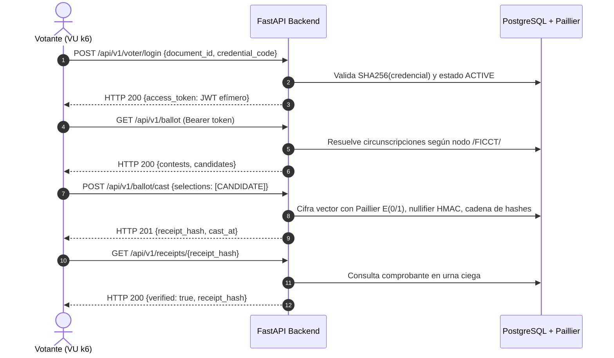

# Guía Oficial de Pruebas de Carga y Concurrencia Masiva (k6) — VotoSeguro v3.0.0

**Módulo:** `S3-04` — Certificación de Rendimiento, Seguridad y Escalabilidad  
**Asignatura:** Ingeniería de Software I (INF 422 SB) — UAGRM  
**Versión de Release:** `v3.0.0` (Sprint 3 Final)

---

## 1. Visión y Objetivos de Rendimiento (Sección 12 — RNF)

El sistema **VotoSeguro v2** opera bajo el requerimiento no funcional de alto rendimiento en jornada electoral masiva:
* **Concurrencia Objetivo:** 1,000 Usuarios Virtuales (VUs) simultáneos interactuando con la cabina de votación.
* **Latencia Crítica en Emisión Homomórfica:** Percentil 95 de duración de la emisión de papeleta atómica menor a 2 segundos:
  $$\text{p}(95) < 2000\text{ ms} \quad \text{en} \quad \text{POST } \texttt{/api/v1/ballot/cast}$$
* **Tasa Máxima de Error:** Menor al 1% de solicitudes totales fallidas (`http_req_failed < 0.01`).
* **Invariantes Criptográficas Activas:**
  1. Cada voto es cifrado asimétricamente con el criptosistema Paillier de 1024/2048 bits (`HomomorphicPaillierVoteCodec` vía `phe`).
  2. Generación de nullifier ciego determinista $\text{HMAC-SHA256}(\text{secret}, \text{voter\_id} \mathbin{\Vert} \text{":"} \mathbin{\Vert} \text{constituency\_id})$.
  3. Encadenamiento estricto en el ledger de la urna (`chain_index`, `prev_hash`, `vote_hash`).
  4. Sellado de comprobante de urna (`receipt_hash`) emitido y validado públicamente.

---

## 2. Estructura del Suite de Carga

```text
tests/load/
├── prepare_load_test_election.py   # Script de aprovisionamiento de 1,000 votantes y credenciales
├── votoseguro_load_test.js         # Script oficial de k6 con rampa hasta 1,000 VUs y thresholds
├── run_load_benchmark.py           # Runner asíncrono en Python con métricas p50, p90, p95 y p99
├── voters_credentials.json         # Dataset exportado de 1,000 electores con credenciales secretas
└── README_LOAD_TESTING.md          # Esta guía técnica completa
```

---

## 3. Prerrequisitos de Instalación

### 3.1 Instalación de k6

* **Windows (vía winget o chocolatey):**
  ```powershell
  winget install k6 --source winget
  # o vía Chocolatey:
  choco install k6
  ```
  *O descargar el instalador oficial MSI desde [k6.io/docs/get-started/installation](https://k6.io/docs/get-started/installation/).*

* **macOS (Homebrew):**
  ```bash
  brew install k6
  ```

* **Linux (Debian/Ubuntu):**
  ```bash
  sudo gpg -k
  sudo gpg --no-default-keyring --keyring /usr/share/keyrings/k6-archive-keyring.gpg --keyserver hkp://keyserver.ubuntu.com:80 --recv-keys C5AD17C747E3415A3642D57D77C6C491D6AC1D69
  echo "deb [signed-by=/usr/share/keyrings/k6-archive-keyring.gpg] https://dl.k6.io/deb stable main" | sudo tee /etc/apt/sources.list.d/k6.list
  sudo apt-get update
  sudo apt-get install k6
  ```

* **Docker (sin instalación de binarios):**
  ```bash
  docker run --rm -i --network=host grafana/k6 run - < tests/load/votoseguro_load_test.js
  ```

---

## 4. Procedimiento de Ejecución Paso a Paso

### Paso 1: Aprovisionamiento de la Elección de Carga

Ejecute el script preparador para generar en la base de datos la elección de prueba en estado `VOTING_OPEN`, configurar el par de claves Paillier, la custodia distribuida de Shamir y generar 1,000 electores activos con sus credenciales de voto:

```bash
# Desde la raíz del repositorio o votoseguro:
cd apps/api
.venv\Scripts\python.exe ../../tests/load/prepare_load_test_election.py --voters 1000
```

Este script:
1. Crea o reutiliza la institución `Universidad Nacional de Pruebas de Carga`.
2. Genera una clave Paillier de 1024 bits y fragmenta la clave de descifrado en 3 custodios con umbral $k=2$.
3. Configura el cargo electoral, circunscripción y candidatos oficiales.
4. Inserta en lotes atómicos 1,000 votantes con estado `ACTIVE` (`CI-LOAD-00001` a `CI-LOAD-01000`).
5. Genera 1,000 credenciales legibles de un solo uso con formato `VS-LOAD-XXXXX-XXXX` y sus hashes SHA-256.
6. Exporta el archivo `tests/load/voters_credentials.json` con los pares `{document_id, credential_code, contest_id, constituency_id, candidate_id}`.

### Paso 2: Ejecución del Test de Carga con k6

Inicie el servidor backend (si prueba en local):
```bash
cd apps/api
.venv\Scripts\python.exe -m uvicorn app.main:app --host 0.0.0.0 --port 8000 --workers 4
```

Ejecute el script de k6:
```bash
# Ejecución local por defecto contra http://localhost:8000/api/v1:
k6 run tests/load/votoseguro_load_test.js

# Ejecución contra entorno de Staging en la nube (Render):
k6 run -e BASE_URL=https://votoseguro-api.onrender.com/api/v1 tests/load/votoseguro_load_test.js
```

### Paso 3: Runner Asíncrono Alternativo en Python (`run_load_benchmark.py`)

Si no dispone del binario `k6` en su estación de trabajo, puede ejecutar el runner asíncrono en Python basado en `httpx` que reproduce exactamente el flujo de votación concurrente y calcula los percentiles estadísticos formales:

```bash
cd apps/api
.venv\Scripts\python.exe ../../tests/load/run_load_benchmark.py --url http://localhost:8000/api/v1 --concurrency 100 --voters 500
```

---

## 5. Escenario de Carga y Etapas Diseñadas

El archivo `votoseguro_load_test.js` modela una jornada electoral de alta intensidad distribuida en 4 fases:

```
VUs
1000 |                  +-----------------------------+
     |                 /                               \
     |                /                                 \
 250 |     +---------+                                   \
     |    /                                               \
   0 +---+-----------+---------------------------------+---+---- Time
        0s          30s                               105s 120s
        [Rampa 1]   [Rampa 2 - Pico]  [Sostenimiento]  [Enfriamiento]
```

1. **Etapa 1 (`30s`):** Rampa suave de `0` a `250` VUs (simula apertura de centros electorales).
2. **Etapa 2 (`45s`):** Rampa de aceleración de `250` a `1,000` VUs (simula hora pico de votación masiva).
3. **Etapa 3 (`30s`):** Sostenimiento continuo a `1,000` VUs en régimen de máxima exigencia simultánea.
4. **Etapa 4 (`15s`):** Enfriamiento progresivo de `1,000` a `0` VUs hasta el cierre.

---

## 6. Flujo Transaccional por Usuario Virtual (VU)

En cada iteración, el VU ejecuta el ciclo de vida completo de un elector:



---

## 7. Umbrales de Aprobación (Thresholds) y Criterios de Calidad

| Métrica | Condición Exigida | Justificación Técnica |
| :--- | :---: | :--- |
| `http_req_duration{endpoint:ballot_cast}` | `p(95) < 2000ms` | **RNF Sección 12:** El 95% de las emisiones atómicas cifradas con Paillier debe responder en menos de 2.0 segundos bajo 1,000 VUs concurrentes. |
| `http_req_failed` | `rate < 0.01` | Menos del 1% de errores en todo el suite (asegura alta disponibilidad y ausencia de bloqueos 500/504). |
| `ballot_error_rate` | `rate < 0.01` | La tasa de papeletas rechazadas o no depositadas debe ser inferior al 1%. |

---

## 8. Recomendaciones de Configuración para Pruebas Extremas

1. **Desactivación Temporal de Rate Limiting:**  
   Para evaluar el rendimiento puro del motor criptográfico sin que el limitador de peticiones por IP (`slowapi`) rechace con `429 Too Many Requests`, establezca en `.env`:
   ```env
   RATE_LIMIT_ENABLED=false
   ```
   *Nota: El script `votoseguro_load_test.js` incluye cabeceras dinámicas `X-Forwarded-For: 10.50.X.Y` para distribuir las IPs virtuales automáticamente en caso de que el limitador esté activo.*

2. **Workers de Uvicorn y Pool de Conexiones:**  
   En servidores de producción o pruebas de estrés, levante Uvicorn con al menos 4 workers:
   ```bash
   uvicorn app.main:app --workers 4 --limit-concurrency 2000
   ```
